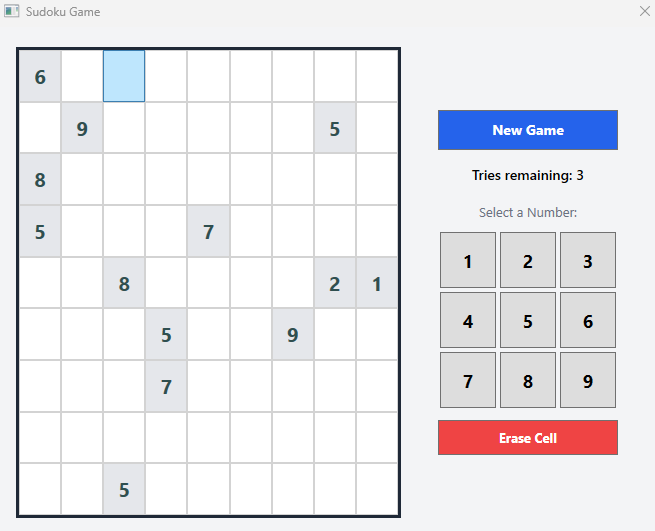

# 🧩 SudokuApp

A Windows desktop Sudoku game built with a **native C++ backend** and a **C# WPF frontend**, with automated CI/CD releases via GitHub Actions.



## 🚀 Features

* **Playable 9x9 Sudoku board:** Click a cell, pick a number, and the game checks your move.
* **Pre-filled clues:** Starting numbers are highlighted in gray and cannot be changed.
* **Limited tries:** A "Tries remaining" counter keeps track of your attempts during a game.
* **Number pad and Erase:** Enter numbers 1 to 9 with on-screen buttons and clear a cell with **Erase Cell**.
* **New Game button:** Start a fresh puzzle at any time.
* **Native C++ backend (`Sudoku.dll`):** Handles puzzle logic, move validation, and duplicate checking.
* **C# WPF frontend (`SudokuWPF.exe`):** Desktop interface built with Windows Presentation Foundation.
* **Automated CI/CD pipeline:** GitHub Actions compiles the C++ and C# code, bundles them, and publishes a ready-to-run `.zip` on every push.

---

## 🎮 How to Play

1. Click **New Game** to generate a puzzle.
2. Click an empty cell. The selected cell turns blue.
3. Click a number from **Select a Number** (1 to 9) to place it.
4. Fill every row, column, and 3x3 box so each contains the digits 1 to 9 exactly once.
5. Use **Erase Cell** to remove a number you placed.
6. Watch **Tries remaining**: wrong moves use up your tries.

---

## 🧱 Tech Stack

| Layer | Technology |
|-------|------------|
| Game logic | C++ (compiled to `Sudoku.dll` with MSVC) |
| User interface | C# / WPF (.NET 8) |
| Interop | P/Invoke (C# calls the native DLL) |
| CI/CD | GitHub Actions |

---

## 📦 Installation & Running

**Requires:** Windows 10/11 (x64) and the [.NET 8 Desktop Runtime](https://dotnet.microsoft.com/download/dotnet/8.0).

1. Head over to the **[Releases](../../releases)** page of this repository.
2. Download the latest **`SudokuApp-Windows.zip`** (not "Source code").
3. Extract the contents into a folder. Keep these files side-by-side:
   * `SudokuWPF.exe`
   * `SudokuWPF.dll`
   * `Sudoku.dll`
   * The other files from the zip (`.json` config files, etc.)
4. Double-click **`SudokuWPF.exe`** to launch the game.

---

## 🛠️ Building from Source

**Prerequisites:** Visual Studio 2022 (with the *Desktop development with C++* and *.NET desktop development* workloads) and the .NET 8 SDK.

### 1. Compile the C++ Backend
Using the **x64 Native Tools Command Prompt for VS**:
```cmd
cl /LD /EHsc Sudoku.cpp /Fe:Sudoku.dll
```

### 2. Publish the WPF App
```cmd
dotnet publish SudokuWPF/SudokuWPF.csproj -c Release -r win-x64 --self-contained false -o publish_output
```

### 3. Add the DLL and Run
Copy `Sudoku.dll` into `publish_output/` next to `SudokuWPF.exe`, then launch the app.

---

## ⚙️ CI/CD

Every push to `main` runs a GitHub Actions workflow that:

1. Sets up the MSVC environment and compiles the C++ DLL
2. Publishes the WPF app with the .NET 8 SDK
3. Packages everything into `SudokuApp-Windows.zip`
4. Creates a GitHub Release with the zip attached

---

